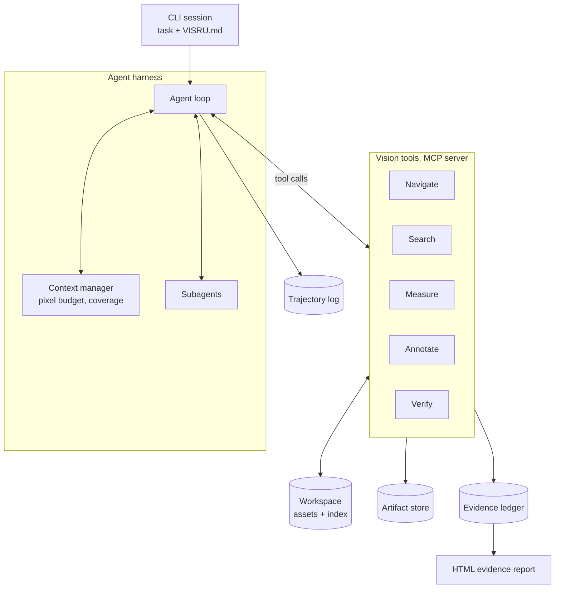

# VisRU

VisRU (Visual Reasoning and Understanding) is an agentic harness that gives a vision-language model a workspace of images, video, and multi-view captures, plus tools to search, zoom, measure, annotate, and check its own conclusions. Every claim in its final answer links to the crop, mask, frame, or overlay that supports it.

The design borrows from coding agents. A codebase is too large to read in one pass, so a coding agent searches, opens the files it needs, edits, and runs tests. visru runs the same loop over pixels.

> Status: pre-alpha.

## A session

```text
$ visru run ./rollouts/pick_place --task "Why did trial 14 fail?"

[1] list_assets(prefix="trial_14")                  -> 1 video, 1,812 frames, 30 fps
[2] sample_frames(trial_14.mp4, n=24)               -> contact sheet a_0003
[3] sample_frames(trial_14.mp4, t=37.5..40.5, n=12) -> contact sheet a_0004
[4] view(frame_1164, box=[812,402,1240,690])        -> a_0005, scale 1.00
[5] segment(a_0005, points=[[1020,560]])            -> mask a_0006 (mark 1: mug handle)
[6] overlay(a_0006 + gripper track)                 -> a_0007
[7] cross_check(c_1, via=["segment", "detect"])     -> agree, IoU 0.84
[8] coverage(trial_14.mp4)                          -> 14% of frames inspected at native scale
[9] submit_report(...)

c_1 [verified]  Gripper closed before reaching the handle at 38.8 s.
                evidence: a_0005, a_0007   checks: cross_tool
c_2 [supported] Left finger occluded the handle from 38.4 s.
                evidence: a_0004
Not inspected at native scale: frames 0 to 1100.
```

## Architecture



**CLI and project context.** A session starts in the terminal. Each workspace can carry a `VISRU.md` with domain context: camera intrinsics, class definitions, what counts as a defect, known failure modes, unit conventions. The harness loads it into the system prompt, the way Claude Code loads `CLAUDE.md`.

**Agent loop.** A tool-use loop. The model plans, calls tools, receives text, images, and artifact IDs, and repeats until it calls `submit_report`. Ending through a tool call forces the final answer into the ledger schema.

**Context manager.** Images dominate context cost, so the context manager keeps a fixed number of live images and replaces older ones with short text notes that carry artifact IDs. It also maintains a coverage map per asset: which regions or frames the model has viewed, and at what scale.

**Workspace.** An asset registry with content-hash IDs and metadata (resolution, fps, intrinsics when known), plus an embedding index built at ingest: one SigLIP embedding per image and per video keyframe, stored in FAISS.

**Artifact store.** Every derived image (view, mask, overlay, contact sheet, plot) is saved with its parent asset, the tool and parameters that produced it, and its coordinate transform. Any image the model saw can be regenerated from the log.

**Tool layer.** Tools run in an MCP server, so any MCP client can use them. Heavy models (detector, segmenter, depth, pointmaps) run in a GPU worker process that loads weights once and batches requests.

**Evidence ledger.** Claims with evidence IDs, the checks run against them, and a status. It renders to a static HTML report where each claim links to its artifacts.

**Trajectory log.** JSONL of every model turn, tool call, tool result, and artifact ID. This becomes the dataset for the research phase.

## Design decisions

### 1. Build the tools as an MCP server before writing a harness

Claude Code already provides the loop, bash and Python execution, subagents, project context files, and compaction. Registering visru's tools with it gives a working prototype in Phase 0 and shows where a coding harness falls short for visual work. Those gaps define the custom harness in Phase 1, and the same server keeps working afterwards.

### 2. One coordinate frame: source-asset pixels

Coordinates are the easiest thing to get silently wrong. The Claude API returns coordinates relative to the image after its own resizing, and every crop adds an offset and a scale. Three rules prevent drift:

- All tool inputs and outputs use source-asset pixel coordinates.
- `view` resizes images itself, to a size the API will not resize again, and returns the transform.
- Detector and segmenter results are drawn as numbered marks (Set-of-Mark style), so the model can refer to "mark 3" instead of emitting raw coordinates.

### 3. Images in context expire; artifacts persist

A live image costs thousands of tokens. After it ages out, the harness swaps it for a note such as `[a_0042 elided: close view of MRZ, OCR read "P<CAN..."]`. The model can call `view("a_0042")` to see it again.

### 4. Verification is a tool category with outputs the ledger enforces

Claims carry one of four statuses:

| Status | Requirement |
|---|---|
| `verified` | At least one evidence artifact and at least one passing independent check |
| `supported` | At least one evidence artifact |
| `contested` | Checks disagree |
| `hypothesis` | No evidence; reported in a separate section |

Two methods count as independent only if they do not share a model. A VLM count checked against a detector count qualifies. SAM masks prompted from detector boxes do not, because they inherit the detector's errors.

### 5. Model-agnostic backends

The Anthropic API for Claude, and an OpenAI-compatible endpoint (vLLM) for open VLMs. The open path matters for research: training on trajectories needs weights you can update.

### 6. Log from day one

Trajectories are cheap to store and impossible to recover later.

## Tools

| Group | Tool | Purpose | Default backing |
|---|---|---|---|
| Navigate | `list_assets` | Filter assets by name, type, metadata | Registry |
| | `view` | Render a region at the model's max resolution, optional source-pixel grid | Pillow |
| | `sample_frames` | Contact sheet of N frames over a time range | PyAV |
| Search | `search` | Text or image query over the embedding index | SigLIP + FAISS |
| | `detect` | Open-vocabulary boxes, rendered as marks | OWLv2 or Grounding DINO |
| | `segment` | Masks from points, boxes, or marks; video propagation | SAM 2 |
| | `ocr` | Text with boxes | PaddleOCR |
| Measure | `python` | Sandboxed kernel with numpy, OpenCV, workspace mounted read-only | Jupyter kernel |
| | `depth` | Monocular depth | Depth Anything V2 |
| | `pointmap` | Multi-view pointmaps, poses, reprojection error | VGGT or DUSt3R |
| Annotate | `annotate` | Draw boxes, masks, labels, arrows | Pillow |
| | `note` | Append a finding to session notes | Harness |
| Verify | `overlay` | Render claimed geometry on the source and return it for re-inspection | Pillow |
| | `cross_check` | Answer the same question with independent methods and compare | Harness |
| | `coverage` | Viewed regions and frames, by scale | Context manager |
| Finish | `submit_report` | Submit claims with evidence IDs; rejects malformed claims | Ledger |

In fp16, the Phase 0 model set (OWLv2, SAM 2, SigLIP, Depth Anything V2) fits on one 24 GB GPU with room to spare. Pointmap models are the exception: VGGT memory grows with the number of views.

## Repository layout

```text
visru/
├── README.md
├── pyproject.toml
├── visru.toml.example
├── VISRU.md.example
├── visru/
│   ├── cli.py                  # visru run | index | report
│   ├── config.py
│   ├── geometry.py             # ViewTransform, fit_render_size
│   ├── trajectory.py           # JSONL logging
│   ├── agent/
│   │   ├── loop.py             # tool-use loop, stop conditions
│   │   ├── context.py          # live-image budget, elision, compaction
│   │   ├── coverage.py         # per-asset viewed-region maps
│   │   ├── subagents.py        # shard work by region, time window, or file
│   │   └── prompts/system.md
│   ├── backends/
│   │   ├── anthropic.py
│   │   └── openai_compat.py    # vLLM and open VLMs
│   ├── workspace/
│   │   ├── registry.py         # content-hash IDs, metadata
│   │   ├── index.py            # embeddings + FAISS
│   │   ├── video.py            # decoding, keyframes
│   │   └── artifacts.py        # derived images with provenance
│   ├── tools/
│   │   ├── registry.py         # schemas, dispatch, result blocks
│   │   ├── navigate.py
│   │   ├── search.py
│   │   ├── measure.py
│   │   ├── annotate.py
│   │   └── verify.py
│   ├── evidence/
│   │   ├── ledger.py
│   │   └── report.py           # static HTML report
│   └── servers/
│       ├── vision_mcp.py       # MCP server exposing visru.tools
│       └── gpu_worker.py       # model hosting and batching
├── evals/
│   ├── suites/                 # vstar, hrbench, video, custom audits
│   ├── baselines.py            # single pass, zoom only, full tools
│   └── score.py
└── tests/
    ├── test_geometry.py        # coordinate round trips
    └── test_tools.py
```

## Build plan

Each phase ends with an exit criterion. Do not start the next phase until it passes.

**Phase 0: tool server inside Claude Code.** Build `geometry.py`, the registry, `view`, `sample_frames`, `detect`, `segment`, `ocr`, `overlay`, and `submit_report` (the ledger lives in the server for now).
*Exit:* on 30 hand-picked high-resolution questions the model fails in a single pass, the tool setup answers at least 20 correctly. You also have written notes on where Claude Code's harness gets in the way, such as image history, coordinate handling, and compaction dropping visual findings.

**Phase 1: own harness.** Agent loop, context manager with elision, artifact provenance, trajectory log, both backends.
*Exit:* a 200-step session over a 1,000-image folder stays inside context limits, and every image the model saw can be regenerated from the log.

**Phase 2: evidence and evaluation.** Ledger statuses, `cross_check`, `coverage`, HTML report, eval harness with three baselines.
*Exit:* a results table on V* Bench and HR-Bench across baselines, plus a first measurement of `verified` versus `supported` accuracy.

**Phase 3: video and subagents.** Keyframe index, temporal search, SAM 2 propagation, one subagent per time window.
*Exit:* on videos with labelled event times, the agent localizes the failure window within a tolerance fixed before running.

**Phase 4: multi-view geometry.** `pointmap`, reprojection checks, metric measurement using intrinsics from `VISRU.md`.
*Exit:* metric distance questions on scenes with ground truth, with reprojection residual reported per claim.

**Phase 5: open models and training data.** Run an open VLM through vLLM on the same harness. Export trajectories whose claims were verified and correct into an SFT format.
*Exit:* the open model completes the Phase 2 suite end to end, and the exported dataset loads in your training code. Research starts here.

## Quick start (Phase 0)

```bash
git clone git@github.com:engichang1467/VisRU.git && cd visru
uv venv && source .venv/bin/activate
uv pip install -e ".[tools]"

# Build the registry and embedding index for a folder
visru index "$(pwd)/sample_data"  

# Register the tool server with Claude Code for all projects
claude mcp add -s user visru -- "$(pwd)/.venv/bin/python" -m visru.servers.vision_mcp \
  --workspace "$(pwd)/sample_data"

# Claude Code reads CLAUDE.md, so use the visru context file under that name
cp VISRU.md.example sample_data/CLAUDE.md
cd sample_data/ && claude
```

Then try:

```text
In the scene_b stills, read every storefront sign on the right side of the street.
Give the text, the asset ID, and the artifact ID of the view you read it from — I
only accept a reading the tool reported at or above inspected_scale. Then count the
pedestrians in the roadway in the first and last scene_b frame, and cross-check both
counts.

In trial_01.mp4, find the frame window where the street-name sign at the intersection
becomes legible, then read it and cite the frame ref.

Tell me which assets you did not inspect at native scale, and why. Finish with
submit_report.
```

`VISRU.md.example` ships the context for `sample_data`. For your own folder the file
carries whatever the model cannot see in the pixels — here, a warehouse set:

```markdown
# Workspace: warehouse inspection set

- 1,240 RGB images, 4032x3024, phone camera, no intrinsics.
- "Torn" means a visible tear through the printed area. Creases do not count.
- Labels are 10x15 cm. Anything smaller is a different sticker.
- Report findings per image ID. Measurements in pixels unless a ruler is visible.
```

## Implementation notes

### Model image limits

Put these in config, since they change between models:

- Claude 4.7 and later models accept up to 2576 px on the long edge and 4784 visual tokens. A visual token is a 28x28 patch, so an image costs `ceil(w/28) * ceil(h/28)`.
- Older models cap at 1568 px and 1568 tokens.
- The API downscales anything larger.
- Once a single request contains more than 20 images, every image must be 2000 px or smaller per side. Images inside earlier `tool_result` blocks count toward that threshold.
- Upload images through the Files API and reference them by `file_id`, so request payloads stay small as history grows.

See the [vision docs](https://platform.claude.com/docs/en/build-with-claude/vision) for current values.

```toml
# visru.toml
[model]
backend = "anthropic"        # or "openai_compatible"
name = "claude-opus-5"
max_edge = 2576
max_visual_tokens = 4784
patch = 28
max_upscale = 2.0

[context]
max_live_images = 16         # stays under the 20-image threshold
elide_batch = 8              # elide in batches to keep the cached prefix stable
compact_at_tokens = 150_000

[coverage]
inspected_scale = 1.0        # rendered px per source px that counts as "inspected"
```

### Geometry

```python
# visru/geometry.py
import math
from dataclasses import dataclass


@dataclass(frozen=True)
class ViewTransform:
    """Maps pixels in a rendered view back to the source asset."""
    asset_id: str
    x0: float        # crop origin, source pixels
    y0: float
    scale: float     # rendered px per source px (aspect ratio preserved)

    def to_source(self, u: float, v: float) -> tuple[float, float]:
        return self.x0 + u / self.scale, self.y0 + v / self.scale

    def to_view(self, x: float, y: float) -> tuple[float, float]:
        return (x - self.x0) * self.scale, (y - self.y0) * self.scale


def fit_render_size(w: int, h: int, max_edge: int, max_visual_tokens: int,
                    patch: int = 28, max_upscale: float = 2.0) -> tuple[int, int, float]:
    """Largest size within the model's limits, so the API never resizes again."""
    s = min(max_upscale, max_edge / max(w, h))
    while True:
        rw, rh = max(1, int(w * s)), max(1, int(h * s))
        if math.ceil(rw / patch) * math.ceil(rh / patch) <= max_visual_tokens:
            return rw, rh, rw / w
        s *= 0.98
```

`tests/test_geometry.py` should round-trip random points through `to_view` and `to_source` across nested crops. These are the most important unit tests in the repo.

### The `view` tool

```python
# visru/servers/vision_mcp.py
import io

from mcp.server.fastmcp import FastMCP, Image
from PIL import Image as PILImage

from visru.config import load_config
from visru.geometry import ViewTransform, fit_render_size
from visru.tools.annotate import draw_grid
from visru.workspace import artifacts, registry

cfg = load_config()
mcp = FastMCP("visru")


@mcp.tool()
def view(asset_id: str, box: list[int] | None = None, grid: bool = False):
    """Show a region of an asset at the highest resolution the model accepts.

    box is [x0, y0, x1, y1] in source-asset pixels; omit it for the whole asset.
    With grid=True, a ruler labelled in source pixels is drawn on the image.
    """
    src = registry.load_image(asset_id)
    x0, y0, x1, y1 = box or (0, 0, src.width, src.height)
    crop = src.crop((x0, y0, x1, y1))

    rw, rh, scale = fit_render_size(crop.width, crop.height, **cfg.model.limits)
    out = crop.resize((rw, rh), PILImage.Resampling.LANCZOS)
    tf = ViewTransform(asset_id, x0, y0, scale)
    if grid:
        out = draw_grid(out, tf)

    art = artifacts.save(out, kind="view", parent=asset_id,
                         params={"box": [x0, y0, x1, y1], "grid": grid}, transform=tf)
    buf = io.BytesIO()
    out.save(buf, format="PNG")
    summary = (f"artifact={art.id} source_box={[x0, y0, x1, y1]} "
               f"scale={scale:.3f} view_px={rw}x{rh}")
    return [Image(data=buf.getvalue(), format="png"), summary]


if __name__ == "__main__":
    mcp.run()
```

### The agent loop (Phase 1)

```python
# visru/agent/loop.py
import anthropic

client = anthropic.Anthropic()


def run(task, cfg, tools, ctx, ledger, trajectory, max_steps=200):
    ctx.add_user(task)
    for step in range(max_steps):
        resp = client.messages.create(
            model=cfg.model.name,
            max_tokens=4096,
            system=ctx.system_prompt(),
            tools=tools.schemas(),
            messages=ctx.render(),
        )
        ctx.add_assistant(resp.content)
        calls = [b for b in resp.content if b.type == "tool_use"]
        if not calls:
            ctx.add_user("Finish by calling submit_report with evidence for each claim.")
            continue

        results = []
        for call in calls:
            out = tools.execute(call.name, call.input)   # text, images, artifact IDs
            trajectory.log(step=step, call=call, result=out)
            results.append({
                "type": "tool_result",
                "tool_use_id": call.id,
                "content": out.blocks(),                  # text and image blocks
            })
            if call.name == "submit_report" and out.ok:
                ctx.add_user(results)
                return ledger.finalize()
        ctx.add_user(results)
        ctx.enforce_budget()                              # elide, then compact if needed
    return ledger.finalize(incomplete=True)
```

### Context budget policy

1. Keep the newest `max_live_images` image blocks inline.
2. When the count goes over, elide the oldest `elide_batch` images at once. Batching keeps the cached prompt prefix valid for longer than eliding one image per turn.
3. Each elision note combines the tool's text summary with the first 300 characters of the model's next message, which is usually its reading of that image.
4. Past `compact_at_tokens`, summarize old turns into session notes. Session notes, the ledger, and the coverage summary always stay in context as structured text.

### Evidence ledger record

```json
{
  "claim_id": "c_1",
  "text": "Gripper closed before reaching the handle at 38.8 s.",
  "status": "verified",
  "evidence": ["a_0005", "a_0007"],
  "checks": [
    {"kind": "cross_tool", "methods": ["segment", "detect"], "result": "agree", "iou": 0.84}
  ],
  "session": "s_20260910_01"
}
```

`submit_report` rejects any non-hypothesis claim without evidence, and any `verified` claim without a passing check.

### Agent instructions

The system prompt in `agent/prompts/system.md` should state these rules plainly:

1. Start coarse: list, search, or sample before zooming.
2. Any claim about a small object or text needs a view at `inspected_scale` or finer.
3. Refer to detections and masks by mark ID.
4. Counts, measurements, and text readings need a `cross_check`.
5. Record findings with `note` as you go.
6. Before submitting, call `coverage` and report what you did not inspect.

## Evaluation

### Running the Phase 0 exit criterion

The Phase 0 criterion compares two arms on the same questions: the model answering
from one downsized image, and the model with the tool server. `evals/` holds the
question schema, the single-pass baseline, and the scorer.

A question set is JSONL, one object per line:

```json
{"id": "q01", "asset": "scene_b_1546479680612194.jpg",
 "question": "What does the vertical neon sign on the right read?",
 "answer": "TRADER JOE'S", "accept": ["trader joes"], "kind": "text"}
```

`asset` is a filename or an asset ID, `kind` is one of `text`, `count`, `localize`,
`temporal`, and `accept` lists extra spellings that should grade as correct.
`answer: null` marks a question nobody has labelled yet. Ground truth has to come
from a person looking at the pixels — seeding it from an agent's own report grades a
run against itself and measures nothing.

Copy the starter set and edit it:

```bash
cp evals/questions.example.jsonl evals/questions.jsonl

# Validate the file and check every asset resolves in the indexed workspace
python -m evals.suite evals/questions.jsonl --workspace sample_data
```

That prints the question count, the breakdown by kind, which questions still need
ground truth, and any asset name that does not exist in the workspace. It exits
non-zero on a missing asset, so it works as a pre-flight check before spending API
calls.

Then run the single-pass control arm:

```bash
# Render every question's image and count tokens without calling the API
python -m evals.baseline --workspace sample_data --questions evals/questions.jsonl --dry-run

# The real run, writing evals/runs/baseline_<timestamp>.jsonl
python -m evals.baseline --workspace sample_data --questions evals/questions.jsonl
```

Each image question is rendered whole at model resolution, which is what a single
pass actually sees. Video questions get a contact sheet instead, since "one
downsized image" has no meaning for a video; the sheet is saved as a workspace
artifact and its ID is printed at the end, so what the baseline was shown stays
inspectable. `--model` overrides the model in `visru.toml` and `--frames` sets the
contact-sheet size.

The tool arm has no runner yet. Run the questions through Claude Code with the MCP
server attached and record the answers by hand, in the same shape, as
`evals/runs/tools_<date>.jsonl`:

```json
{"id": "q01", "arm": "tools", "answer": "TRADER JOE'S"}
```

Score the arms against each other:

```bash
python -m evals.score --questions evals/questions.jsonl \
    evals/runs/baseline_*.jsonl evals/runs/tools_*.jsonl
```

The scorer normalises case, punctuation, and apostrophes before comparing, takes the
first integer for `count` questions, and prints a per-question table of the
questions the arms disagree on — which is the interesting part, since the exit
criterion is about questions single-pass fails and tools get right.

Anything it cannot decide mechanically is marked `review` rather than guessed: an
answer that contains the ground truth inside a longer sentence, or a count answer
with several numbers in it. Settle those by adding `"correct": true` or `false` to
the line in the run file and scoring again. A human verdict always wins over the
grader.

Run output is gitignored. Question sets are not — the set is the artifact worth
keeping.

**Public benchmarks.** V* Bench and HR-Bench (4K/8K) for small details in large images, MME-RealWorld for high-resolution real-world scenes, and Video-MME and LongVideoBench for long video.

**Custom suites.** Inject known label errors into a dataset and measure recall. Add document inspection tasks and multi-view metric questions with ground truth.

**Baselines.** The same model in a single pass on the downsized image, the same model with `view` only (zoom-only), and the full tool set.

**Metrics.**
- Task accuracy.
- Evidence precision: the share of cited artifacts that actually support their claim, from a human audit of a sample.
- Status calibration: accuracy of `verified` claims versus `supported` ones.
- Coverage.
- Visual tokens, tool calls, and wall-clock time per task.

## Open questions for the research phase

- Do the checks predict correctness? If `verified` claims are no more accurate than `supported` ones, the verification layer needs redesigning.
- Where should looking happen: inside the model through learned token selection (LookWhere-style), or outside through tool calls? At what resolution or corpus size does the answer flip?
- Can trajectories ending in verified, correct claims train an open VLM (SFT, then RL) to reach the same answers with fewer visual tokens?
- What stopping rule tells the agent it has looked enough? Coverage thresholds are a starting point.
- How much of the gain comes from zoom alone?

## References

- Gupta and Kembhavi. [Visual Programming: Compositional Visual Reasoning without Training](https://arxiv.org/abs/2211.11559). CVPR 2023.
- Surís, Menon, Vondrick. [ViperGPT: Visual Inference via Python Execution for Reasoning](https://arxiv.org/abs/2303.08128). ICCV 2023.
- Hu et al. [Visual Sketchpad: Sketching as a Visual Chain of Thought for Multimodal Language Models](https://arxiv.org/abs/2406.09403). NeurIPS 2024.
- Wu and Xie. [V*: Guided Visual Search as a Core Mechanism in Multimodal LLMs](https://arxiv.org/abs/2312.14135). CVPR 2024.
- Yang et al. [Set-of-Mark Prompting Unleashes Extraordinary Visual Grounding in GPT-4V](https://arxiv.org/abs/2310.11441). arXiv 2023.
- Zheng et al. [DeepEyes: Incentivizing "Thinking with Images" via Reinforcement Learning](https://arxiv.org/abs/2505.14362). arXiv 2025.
- Fuller et al. [LookWhere? Efficient Visual Recognition by Learning Where to Look and What to See from Self-Supervision](https://arxiv.org/abs/2505.18051). arXiv 2025.
- Ravi et al. [SAM 2: Segment Anything in Images and Videos](https://arxiv.org/abs/2408.00714). ICLR 2025.
- Minderer et al. [Scaling Open-Vocabulary Object Detection (OWLv2)](https://arxiv.org/abs/2306.09683). NeurIPS 2023.
- Liu et al. [Grounding DINO](https://arxiv.org/abs/2303.05499). ECCV 2024.
- Zhai et al. [Sigmoid Loss for Language Image Pre-Training (SigLIP)](https://arxiv.org/abs/2303.15343). ICCV 2023.
- Yang et al. [Depth Anything V2](https://arxiv.org/abs/2406.09414). NeurIPS 2024.
- Wang et al. [DUSt3R: Geometric 3D Vision Made Easy](https://arxiv.org/abs/2312.14132). CVPR 2024.
- Wang et al. [VGGT: Visual Geometry Grounded Transformer](https://arxiv.org/abs/2503.11651). CVPR 2025.
- Wang et al. [Divide, Conquer and Combine (HR-Bench)](https://arxiv.org/abs/2408.15556). AAAI 2025.
- Zhang et al. [MME-RealWorld](https://arxiv.org/abs/2408.13257). ICLR 2025.
- Fu et al. [Video-MME](https://arxiv.org/abs/2405.21075). CVPR 2025.
- Wu et al. [LongVideoBench](https://arxiv.org/abs/2407.15754). NeurIPS 2024 Datasets and Benchmarks.
- Claude vision docs: https://platform.claude.com/docs/en/build-with-claude/vision